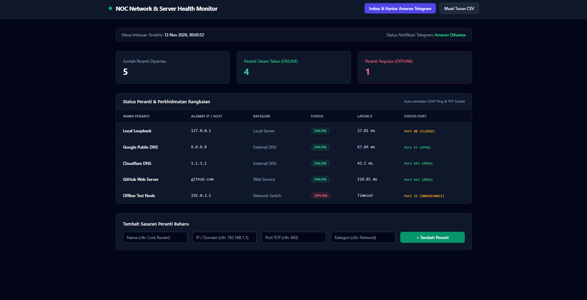

# NOC Network & Server Health Monitor

Sistem pemantauan kesihatan rangkaian dan pelayan berasaskan **Python** dan **Flask** yang dilengkapi dengan papan pemuka web (_NOC Dashboard_), amaran masa nyata melalui **Telegram Bot API**, serta penjanaan laporan audit harian dalam format CSV.

Direka untuk mengautomasikan tugasan diagnostik awal (_L1/L2 IT Support & Network Operations_) bagi pelayan, peranti rangkaian, dan pencetak pejabat (_Network Printers_).

---

## Ciri-Ciri Utama

- **NOC Web Dashboard (Flask + Tailwind CSS):** Memaparkan status semua peranti secara visual (_ONLINE / OFFLINE_), masa pendam (_latency_), serta status port TCP dalam satu paparan mod gelap yang kemas.
- **Imbasan Serentak (Multithreading):** Menggunakan `ThreadPoolExecutor` untuk mengimbas puluhan alamat IP secara selari dan pantas.
- **Diagnostik Lapisan Rangkaian & Servis:**
  - **ICMP Ping (Layer 3):** Menguji ketersediaan hos dan mengukur masa respon (`ms`) merentasi Windows, Linux, dan macOS.
  - **Semakan Port TCP (Layer 4/7):** Mengesahkan status perkhidmatan kritikal seperti Web (`80`/`443`), SSH (`22`), DNS (`53`), Pangkalan Data (`3306`), dan Pencetak Rangkaian (`9100`/`631`).
- **Amaran Segera Telegram Bot:** Menghantar notifikasi amaran secara automatik ke Telegram apabila terdapat peranti terputus sambungan (`OFFLINE`) atau servis port tertutup (`CLOSED`).
- **Pengurusan Sasaran Dinamik & Eksport CSV:** Tambah sasaran peranti baharu terus melalui borang web atau `devices.csv`, dan muat turun laporan audit bertanda masa dari direktori `reports/`.

---

## Pratonton Antaramuka & Amaran

| NOC Web Dashboard | Notifikasi Amaran Telegram |
| :---: | |
| |  |

---

## Struktur Direktori Projek

```text
Network-Health-Monitor/
├── docs/
│   ├── dashboard-ui.png       # Tangkapan skrin antaramuka web
│   └── telegram-alert.png     # Tangkapan skrin notifikasi Telegram
├── reports/
│   └── .gitkeep               # Direktori simpanan laporan imbasan CSV
├── templates/
│   └── index.html             # Antaramuka papan pemuka web (Tailwind CSS)
├── .env.example               # Templat konfigurasi Token & Chat ID Telegram
├── .gitignore                 # Pengecualian fail sensitif (.env) dan log CSV tempatan
├── app.py                     # Pelayan web Flask & laluan API
├── devices.csv                # Senarai sasaran pelayan, rangkaian & pencetak
├── monitor.py                 # Enjin imbasan multithreaded & integrasi Telegram API
├── README.md                  # Dokumentasi projek
└── requirements.txt           # Senarai kebergantungan pakej Python


```Panduan Pemasangan

1. Bash
git clone [https://github.com/2230285/Network-Health-Monitor.git](https://github.com/2230285/Network-Health-Monitor.git)
cd Network-Health-Monitor

2. Bash
python -m pip install -r requirements.txt

3. Salin fail .env.example dan namakan semula sebagai .env:

4. Masukkan Bot Token (daripada @BotFather) dan Chat ID (daripada @userinfobot) di dalam fail .env:
   TELEGRAM_BOT_TOKEN=your_bot_token_here
   TELEGRAM_CHAT_ID=your_chat_id_here

5. Tetapkan Senarai Peranti (devices.csv).
   Ex : device_name,ip_address,port,category
        Local Loopback,127.0.0.1,80,Local Server
        Google Public DNS,8.8.8.8,53,External DNS
        Cloudflare DNS,1.1.1.1,443,External DNS
        Office Network Printer,192.168.1.50,9100,Network Printer

6. Bash
python app.py (Click Running On Http://xxx.x.x.x)

7. Bash
python monitor.py (CLI Mode)

